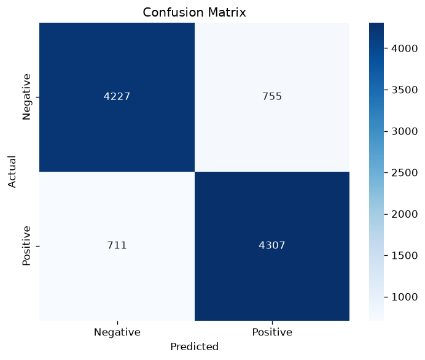
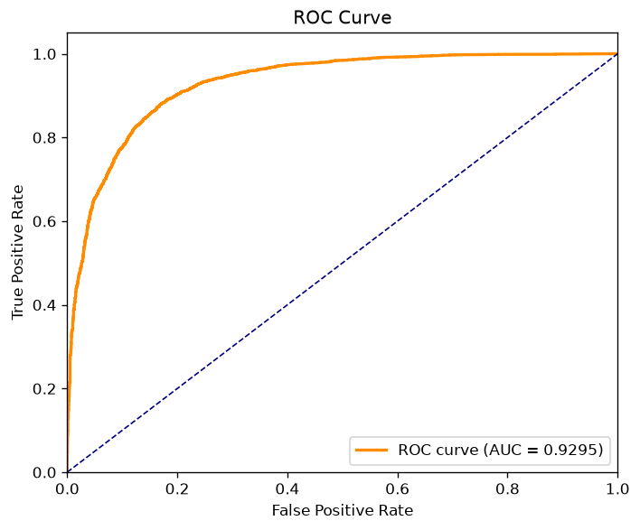
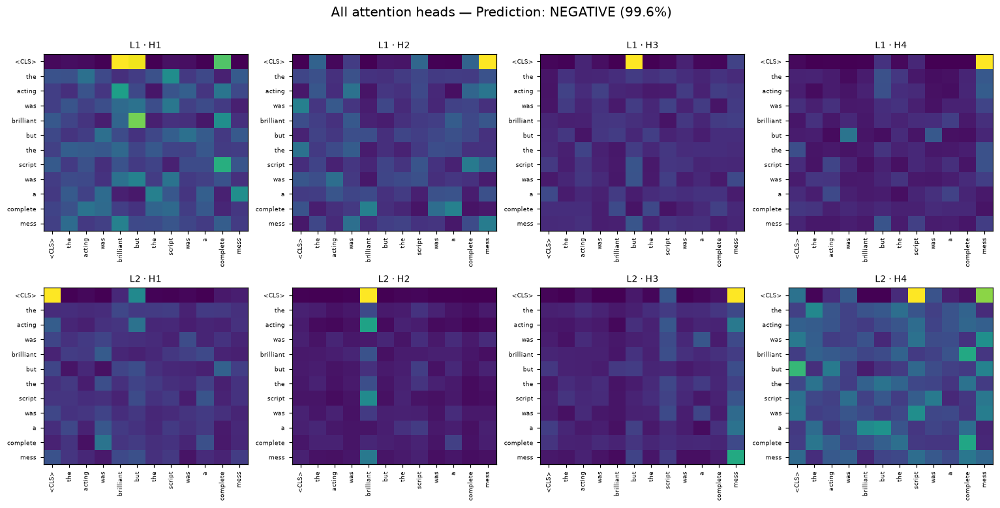
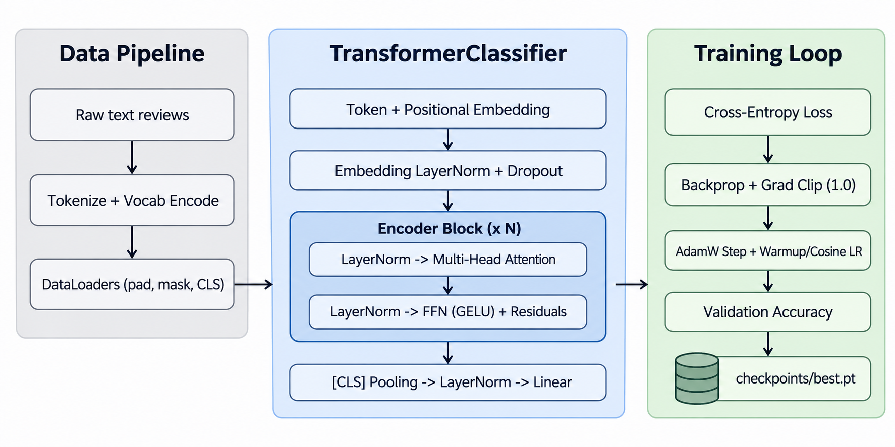

# Transformer Sentiment Classifier (from Scratch)

A complete implementation of a Transformer Encoder for sentiment analysis, built from scratch in PyTorch. No `nn.Transformer`, no HuggingFace, and no pre-trained weights. Every component—multi-head attention, layer normalization, positional embeddings, and the training loop—is written manually to demonstrate a deep understanding of the underlying mathematics.

## 📊 Results

We conducted a scaling experiment to evaluate the model's performance. Even with 3x more parameters and double the training time, the accuracy plateaued around 85%. This indicates that for the IMDB dataset, the bottleneck is likely the word-level vocabulary (10k) rather than the model's capacity.

| Model Configuration | Parameters | Epochs | Time (GTX 1060) | Test Accuracy | F1-Score | ROC AUC |
| :--- | :--- | :--- | :--- | :--- | :--- | :--- |
| **Base** (d_model=128, layers=2) | 1.7M | 5 | ~5 min | 85.02% | 0.8530 | ~0.929 |
| **Large** (d_model=256, layers=4) | 5.7M | 10 | ~40 min | **85.34%** | **0.8546** | **0.9295** |

### Error Analysis & Insights
Interestingly, the model struggles most with **complex negations and mixed sentiments**. For example, a review that is actually positive might start with *"This low-budget erotic thriller that has some good points, but a lot more bad ones..."* and the model confidently predicts NEGATIVE (99.95% confidence). It latches onto the negative words and misses the overall positive context.

### Visualizations

**Confusion Matrix:**


**ROC Curve:**


**Attention Heatmaps (Layer 2):**
The model's attention mechanism focuses on different words to build the sentence representation.


## 🏗️ Architecture

The project pipeline is divided into three stages: Data Pipeline, Transformer Classifier, and Training Loop.



- **Token + Positional Embeddings**: Learned embeddings (dim = 256).
- **Transformer Encoder**: 4 stacked layers (d_model = 256, n_heads = 8, d_ff = 1024).
- **Pre-LayerNorm**: Layer normalization is applied before attention and FFN for training stability.
- **Residual Connections**: Applied around both attention and FFN sub-layers.
- **Classification Head**: A linear layer on the `<CLS>` token representation.

## 🚀 How to Run

```bash
# 1. Install dependencies
pip install -r requirements.txt

# 2. Train the model (Large configuration)
python -m src.train --d_model 256 --n_layers 4 --n_heads 8 --d_ff 1024 --epochs 10 --lr 1e-4

# 3. Evaluate
python -m src.evaluate

# 4. Interactive prediction
python -m src.predict --text "The cinematography was beautiful but the story was predictable."

# 5. Visualize attention
python -m src.visualize --text "The acting was brilliant, but the script was a complete mess."
```

## 📚 References
- Vaswani et al., Attention is All You Need, 2017.

- Devlin et al., BERT: Pre-training of Deep Bidirectional Transformers, 2018.